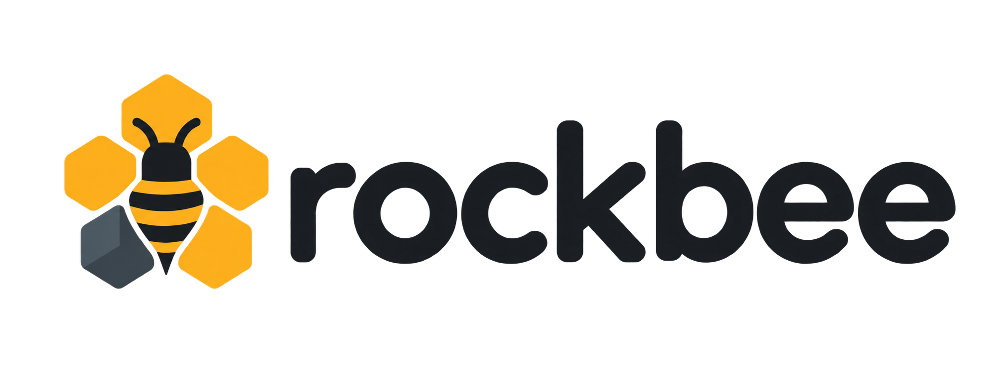

<p align="center">
  
</p>

<h2 align="center">Simple by key. Powerful with SQL.</h2>

<p align="center">
  A Rust database for key-value data and flexible JSON.<br>
  Query with SQL. Keep data in object storage. Scale readers independently.
</p>

<p align="center">
  <a href="https://umitunal.net/rockbee/">Website</a> ·
  <a href="#try-it-locally">Get started</a> ·
  <a href="#json-tables-and-sql">See the API</a> ·
  <a href="#where-it-fits">Use cases</a> ·
  <a href="#how-it-works">Architecture</a> ·
  <a href="crates/rockbee-client/README.md">Documentation</a>
</p>

<p align="center">
  <a href="https://github.com/umit/rockbee/actions/workflows/ci.yml"></a>
</p>

| Look up by key | Query with SQL | Scale your readers |
| --- | --- | --- |
| Store bytes or JSON. Retrieve a value by its key or document ID. | Filter and aggregate JSON tables with DuckDB. Get JSON rows back. | Add reader compute as traffic grows, with durable data in shared object storage. |

## JSON tables and SQL

A product can have a brand and price. Another can have an author and ISBN.
Documents share a table without needing identical fields.

```rust
use rockbee_client::RockBeeClient;
use serde_json::json;

let client = RockBeeClient::connect(&std::env::var("GATEWAY_ADDR")?).await?;
let products = client.table("products");

// Store a document. Rockbee generates the ID.
let write = products.put(&json!({
    "name": "Wireless Mouse",
    "brand": "Logitech",
    "price": 79.90
}));
let id = write.await?; // The writer has made this write durable.

// Read by ID; this may be None until the reader catches up.
let product = products.get(&id).await?;

// Run after the background Parquet publication catches up.
let result = products.query(
    "SELECT value->>'name' AS name, value->>'brand' AS brand
     FROM products
     WHERE value->>'brand' = 'Logitech'
     LIMIT 10"
).await?;
```

Example `result.rows`, after the document is published:

```json
[{"name": "Wireless Mouse", "brand": "Logitech"}]
```

GET and SQL are **eventual**: a new write can take time to appear. SQL reads a
Parquet projection published in the background. The [runnable example](crates/rockbee-client/examples/tables.rs)
shows how to wait for your documents to become visible.

Use `put_key` to supply your own ID, `delete` to remove a document, or TTL to
expire it. [Explore the table API →](crates/rockbee-client/README.md#json-tables-and-sql)

## Use the Rust RockBeeClient

For plain key-value data, the same client works with opaque bytes:

```rust
client.put(b"product:42:badge", b"bestseller", None).await?;
let badge = client.get(b"product:42:badge").await?;
client.delete(b"product:42:badge").await?;
```

PUT returns an eager completion handle; awaiting it observes the durable result.
The client never automatically replays an uncertain mutation.
[Client behavior and guarantees →](crates/rockbee-client/README.md)

## Where it fits

Use Rockbee to serve application data, background job outputs, and AI results
when reads can catch up asynchronously. Expand a category for examples.

<details>
<summary><strong>E-commerce and product catalogs</strong></summary>

| Use case | What you store | How you use it |
| --- | --- | --- |
| Product catalogs | JSON documents with names, brands, categories, and product-specific attributes. | Fetch a product by ID or use SQL to filter and inspect the published catalog. |
| Product enrichment | Generated descriptions, normalized specifications, tags, and image labels. | Background jobs update documents; storefronts read the latest version visible to their reader. |
| Storefront cards | Prepared product cards, category summaries, and promotional content. | Retrieve by key, with optional TTL for content that should expire. |

These fit browsing and discovery flows. Checkout inventory, payments, and
other decisions requiring immediate consistency need a transactional store.

</details>

<details>
<summary><strong>AI and machine learning</strong></summary>

Keep model outputs, saved context, and run history in flexible JSON records.
Retrieve by key and explore published table data with SQL.

| Use case | What you store | How you use it |
| --- | --- | --- |
| Model outputs | Summaries, classifications, and generated descriptions. | Reuse completed results by a key identifying the model version and input revision. |
| Agent context | Conversation summaries, preferences, document references, and selected tool results. | Load a saved snapshot by conversation or task ID to assemble the next prompt. |
| Evaluations | Run IDs, model versions, datasets, and evaluation scores. | Compare published results with SQL filters and aggregates. |
| Chat & agent logs | Messages, tool calls, results, statuses, and durations, grouped by conversation and run. | Store each event by ID; inspect published events with SQL in application-supplied sequence order. |
| Prompt versions | Prompt text and model settings under an explicit version ID, such as `support-agent:v3`. | Let your application select the version to load for each request. |
| Recommendations | Precomputed product or content IDs for a user or segment. | Read a recommendation list by key while a pipeline refreshes it in the background. |
| Feature serving | Pipeline-computed ML features under an entity-and-version key. | Fetch prepared features by key when serving predictions. |
| User feedback | Ratings and comments linked to a response or model version. | Query published feedback with SQL to inspect ratings and compare results. |

Your application runs the models and selects the context; Rockbee stores and serves the data.
Feature vectors are values retrieved by key, not a vector similarity index.

[Explore the AI examples on the website →](https://umitunal.net/rockbee/#ai)

</details>

<details>
<summary><strong>Content and application data</strong></summary>

| Use case | What you store | How you use it |
| --- | --- | --- |
| Content catalogs | Articles, media metadata, tags, and flexible document fields. | Retrieve by ID and inspect published content with SQL. |
| Reference data | Category labels, display settings, and enrichment mappings. | Share slowly changing lookup data across application services. |
| External API results | Previously fetched metadata or computed responses, optionally with TTL. | Reuse values until they expire or your application refreshes them. |

</details>

<details>
<summary><strong>Reporting and analytics results</strong></summary>

| Use case | What you store | How you use it |
| --- | --- | --- |
| Dashboard snapshots | Prepared sales, campaign, or operational metrics. | Serve the latest available snapshot by report ID. |
| Batch outputs | Completed reports and job summaries. | Publish from background jobs and retrieve them through the same client. |
| SQL summaries | JSON table records with the fields your report needs. | Filter and aggregate the published Parquet projection with DuckDB. |

Large processing jobs can run in your existing warehouse or pipeline. Reader
SQL has explicit [query limits](crates/rockbee-query/README.md#query-behavior-and-bounds).

</details>

## How it works

### More read traffic? Add reader compute.

Rockbee separates the processes serving requests from the storage keeping your
data. Add readers against the same dataset and configure the gateway to use
them. Each reader brings its own compute and cache; it does not need a full
durable copy of the database.

```text
                         +--> Writer  -- SlateDB writes --> Object storage
RockBeeClient -> Gateway -+
                         +--> Readers -- SlateDB GET / DuckDB SQL
                                             ^
                              Shared durable data + Parquet
```

- **Gateway** gives the client one endpoint and routes writes and reads.
- **Writer** makes mutations durable through SlateDB and uses DuckDB to publish
  JSON table data as Parquet in object storage.
- **Readers** serve key lookups through SlateDB and SQL through DuckDB over
  locally cached Parquet files.

There is one writer per storage prefix. Readers catch up asynchronously.
Adding readers grows serving resources independently of writer compute;
throughput depends on the workload and the rest of the system.

Built with [SlateDB](https://github.com/slatedb/slatedb) for persistence and
[DuckDB](https://github.com/duckdb/duckdb) for SQL.
[Query architecture →](crates/rockbee-query/README.md)

## Try it locally

Requires **Rust**, a **C++ toolchain** for bundled DuckDB, and **Docker**.
[macOS and RustRover setup →](DEVELOPMENT.md)

Reuse an existing compatible LocalStack instance with bucket `rockbee-test`.
If none is running and port **4566 is free**, start one:

```sh
docker compose up -d --wait
```

Start Rockbee:

```sh
make local
```

The runner starts a writer, reader, and gateway with a unique storage prefix.
In another terminal, use the gateway address printed in its output:

```sh
export GATEWAY_ADDR='127.0.0.1:PORT_FROM_READY_OUTPUT'
./target/release/rockbee-client --addr "$GATEWAY_ADDR" put product:42 available
./target/release/rockbee-client --addr "$GATEWAY_ADDR" get product:42
```

Retry GET while the reader catches up. Ctrl-C stops the runner's own processes
and preserves stored data. [Full local setup →](DEVELOPMENT.md#try-it-locally)

---

**Clients:** [Rust](crates/rockbee-client/README.md) is available. **Java and Go clients coming soon.**

<p align="center">
  <a href="crates/rockbee-client/README.md"> Rust SDK</a> &nbsp; · &nbsp;
  <a href="crates/rockbee-query/README.md"> SQL &amp; Parquet</a> &nbsp; · &nbsp;
  <a href="tools/rockbee-cli/README.md"> Command line</a> &nbsp; · &nbsp;
  <a href="tools/rockbee-cdc/README.md"> CDC</a>
</p>

<p align="center">
  <a href="DEVELOPMENT.md"> Development</a> &nbsp; · &nbsp;
  <a href="CONTRIBUTING.md"> Contributing</a> &nbsp; · &nbsp;
  <a href="LICENSE"> Apache 2.0</a>
</p>

Thanks to [Chris Riccomini](https://github.com/criccomini) and the SlateDB contributors.
