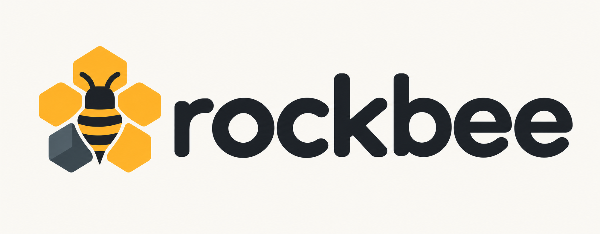
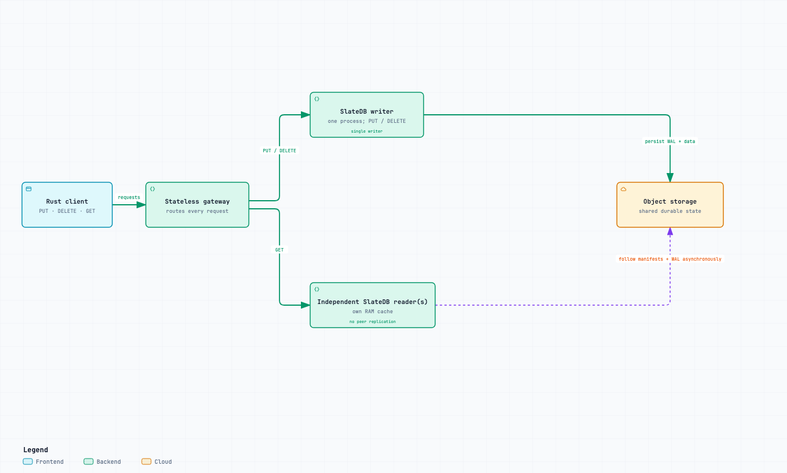

<p align="center">
  
</p>

<p align="center">
  <strong>A simple key-value service with durable object storage and independent readers.</strong><br>
  Built in Rust on <a href="https://github.com/slatedb/slatedb">SlateDB</a>.
</p>

<p align="center">
  <a href="https://github.com/umit/rockbee/actions/workflows/ci.yml"></a>
</p>

<p align="center">
  <a href="https://umitunal.net/rockbee/">Website</a> ·
  <a href="#try-it-locally">Quick start</a> ·
  <a href="#how-it-works">Architecture</a> ·
  <a href="#where-it-fits">Use cases</a> ·
  <a href="crates/rockbee-client/README.md">Rust client</a> ·
  <a href="tools/rockbee-cdc/README.md">CDC</a>
</p>

Rockbee puts a small byte-oriented API in front of [SlateDB](https://github.com/slatedb/slatedb):
`PUT`, `GET`, and `DELETE`, with optional TTL. One writer persists changes to
S3-compatible storage; independent readers serve lookups from their own SlateDB
state and RAM caches. A gateway gives applications one endpoint for both paths.

The design separates serving compute from the durable storage layer. Readers
follow the same stored data without copying updates between reader peers. That
makes Rockbee a project to explore for read-heavy, asynchronously updated views
where applications can tolerate older results while readers catch up.

**Status:** active local pilot, validated with Docker LocalStack. Production AWS
operation, TLS, automatic writer failover, and capacity limits remain outside the
verified scope.

## How it works



[SVG diagram](.github/assets/rockbee-how-it-works.svg)

1. **Write once through the writer.** The gateway sends `PUT` and `DELETE` to the
   single writer for a storage prefix. SlateDB persists the write-ahead log (WAL)
   to object storage. Success is returned only after the durable acknowledgement.
2. **Read through independent readers.** The gateway distributes `GET` requests
   across configured readers with round-robin selection. Each reader follows
   manifests and WAL updates and fetches sorted table files (SSTs) through
   SlateDB, with its own RAM cache. The gateway has no key/value cache.
3. **Allow time for visibility.** A durable write may not yet be visible through
   a reader. A `GET` can return an older value or `None` until that reader catches
   up. Readers do not replicate directly to each other.

Keys and values are opaque bytes: Rockbee does not interpret JSON, documents, or
application schemas. All KV operations require a nonempty key; `PUT` also requires a
nonempty value. Binary zero bytes are valid. TTL is optional and expiration is
checked on reads. There is one writer per prefix, with no sharding or automatic
writer failover.

The Rust Client uses bounded, multiplexed TCP requests. `put()` immediately
returns a completion handle; awaiting it observes local rejection or the durable
write result. Mutation errors distinguish `NotSent`, `Rejected`, and `Unknown`.
An uncertain write may have succeeded, so it is never automatically replayed.
See the [SDK guide](crates/rockbee-client/README.md) for completion and error semantics.

## Where it fits

Rockbee is designed for applications that need a simple key-value API and want
to scale read capacity independently of durable storage. E-commerce catalogs,
recommendation services, content platforms, and applications serving reporting
or AI/ML results can use it to retrieve data by key.

**Rockbee separates serving compute from durable storage.** SlateDB persists
data in shared object storage, while independent readers serve point lookups
with their own RAM caches. Readers can be added as serving demand grows without
tying the durable dataset to any one process. Applications can write directly or
publish values from background jobs through the byte-oriented `PUT`, `GET`, and
`DELETE` API, with optional TTL on writes. Readers follow updates asynchronously,
so an acknowledged write may not be visible immediately through a reader.

The goal is a robust, understandable serving layer: durable write
acknowledgements, bounded concurrent requests, and storage that outlives
individual service processes.

| Use case | What a key holds | Why eventual reads may be acceptable |
| --- | --- | --- |
| Product enrichment | `product:42:enrichment` → generated descriptions, tags, or image-analysis results | Enrichment runs asynchronously; an earlier result can remain useful while a new one arrives. |
| Catalog read models | `product:42:card` → a prepared product card or display metadata | Browse pages may tolerate delayed descriptive updates. Checkout price and stock decisions need stronger freshness guarantees. |
| Recommendation lists | `user:123:recommendations` → precomputed item IDs and scores | Lists refresh periodically; serving the previous list can be acceptable between refreshes. |
| Precomputed ML features | `item:42:features` → an application-encoded feature vector | An inference service fetches features by key before running a model, where feature freshness requirements allow reader lag. |
| AI inference results | `model:v3:item:42` → generated labels, classifications, or summaries | A pipeline runs inference and publishes the result; applications reuse it until a newer result becomes visible. |
| Data science experiment outputs | `experiment:42:metrics` → evaluation metrics or a compact experiment summary | A notebook or batch job publishes results for applications and dashboards to retrieve by experiment ID. |
| Reference lookups | `category:17` → labels, display hierarchy, or enrichment mappings | Slowly changing, noncritical reference data can often tolerate delayed visibility. |
| Rendered content | `page:campaign-7` → a generated page fragment or serialized display model | Content is prepared ahead of time; publication workflows can allow a propagation window. |
| External API result caching | `provider:item:42` → a reusable response with optional TTL | An expensive response can be reused and refreshed by the application. The caller must tolerate cache misses and stale reader views. |
| Batch results and reporting snapshots | `report:daily:2026-10-09` → one completed aggregate or report payload | Producers publish completed results for repeated point reads; readers do not need to observe every intermediate update. |
| DWH dashboard results | `sales:store:42:2026-10-10` → a precomputed daily sales summary | A warehouse job calculates the summary and exports it; a dashboard fetches the prepared result by key and accepts a refresh delay. |

For reporting and AI/ML workloads, the upstream pipeline handles queries,
aggregation, training, or inference and publishes the resulting values. Rockbee
serves those values by key. Exporting and refreshing them is the application's
responsibility. Versioned keys can identify a specific report run or model output.

The key names above are application conventions. Values may contain JSON,
Protobuf, compressed content, or another encoding chosen by the caller; Rockbee
treats them as bytes. Each record must fit the protocol's frame limits. Store a
reference to a large artifact rather than putting an entire file in one value.
TTL hides expired records on reads; it does not schedule refreshes or promise
immediate physical deletion from object storage.

**Why use object storage here?** Durable data lives independently of a particular
writer or reader process. Each reader can keep a working set in its own SlateDB
RAM cache and fetch other data from the shared object store. Adding readers adds
serving compute and cache capacity without assigning each reader its own
authoritative dataset. Readers can cache overlapping data, and the single
writer still bounds write capacity for that prefix.

This trades immediate visibility and local-storage latency for a shared durable
storage layer. A warm cache hit and a cold object-store fetch have different
costs. More readers do not guarantee linear throughput gains, and object storage
alone does not guarantee faster reads or lower total cost. Measure cache state,
key distribution, value size, request volume, and acceptable reader lag with the
intended workload. LocalStack results do not establish production S3 capacity.

**Choose another storage model when correctness requires:**

- Immediate read-after-write visibility, such as confirming a just-submitted
  change through any reader.
- Transactions, compare-and-swap, atomic counters, or coordinated updates across
  keys, such as inventory reservations, balances, and payment state.
- Distributed locks, strict rate-limit enforcement, or immediate security and
  permission revocation.
- SQL, secondary indexes, document queries, range scans, or vector search through
  the public API. Rockbee currently exposes point `PUT`, `GET`, and `DELETE`.
- Automatic writer failover or distributed write sharding, which this version
  does not implement.

For an existing database migration, first identify a workload that uses only
these point operations and accepts eventual reads. Validate its failure handling,
freshness, and capacity independently; matching a key-value API does not make
Rockbee a drop-in replacement for every database feature.

## Try it locally

You need Rust installed through rustup and Docker Desktop. The repository pins
the development toolchain in `rust-toolchain.toml`. Use an existing compatible
LocalStack instance with bucket `rockbee-test`. Only if no compatible instance is
running **and port 4566 is free**, start the repository's Compose service:

```sh
docker compose up -d --wait
```

If another service occupies that port, use your existing compatible LocalStack
endpoint and bucket with `make local ENDPOINT=http://HOST:PORT BUCKET=NAME`.
For the default endpoint, start a disposable topology:

```sh
make local
```

This builds the release binaries and starts a writer, reader, and gateway with a
unique storage prefix. It prints **dynamic loopback addresses**. Copy the printed
gateway address into a second terminal; it is not necessarily port 7100:

```sh
export GATEWAY_ADDR='127.0.0.1:PORT_FROM_READY_OUTPUT'
./target/release/rockbee-client --addr "$GATEWAY_ADDR" put demo:key demo-value
./target/release/rockbee-client --addr "$GATEWAY_ADDR" get demo:key
./target/release/rockbee-client --addr "$GATEWAY_ADDR" delete demo:key
```

The first GET may be missing while the reader catches up. To observe convergence,
repeat GET before deleting the key. Stop traffic and await outstanding PUT
handles before Ctrl-C. The runner stops only its owned processes and retains
storage data and logs; it does not manage or remove existing LocalStack
containers. Shutdown allows a shared 30-second grace period before force-stopping
remaining owned children; a forced stop does not guarantee pending writes.

For fixed addresses and a reusable prefix, run these in separate terminals:

```sh
make writer PREFIX=demo
make reader PREFIX=demo
make gateway
```

Start the writer first, then the reader, then the gateway. This workflow uses
ports `7101`, `7102`, and `7100`, respectively. Both storage nodes must use the
same bucket and prefix. Run `make help` for endpoint and address overrides.
The command-line client defaults to `127.0.0.1:7100` when `--addr` is omitted.

Check configuration before starting the services:

```sh
./target/release/rockbee-writer --config configs/writer.toml --check-config
./target/release/rockbee-reader --config configs/reader.toml --check-config
./target/release/rockbee-gateway --config configs/gateway.toml --check-config
```

These commands print effective settings as JSON and exit without starting the
services. Gateway validation checks addresses and limits locally; it does not
check DNS, backend reachability, or backend roles.

`make gateway` reads [configs/gateway.toml](configs/gateway.toml) for its
listener, writer, readers, and existing upstream/RPC limits. Override the file
with `GATEWAY_CONFIG=path/to/gateway.toml`. Explicit CLI flags take precedence
over TOML, then built-in defaults; CLI `--reader` entries replace the entire
file reader list. Unknown TOML fields are rejected. Explicit Make overrides
such as `make gateway READER_ADDR=127.0.0.1:7202` still work and replace that
list with the supplied reader. Configuration is loaded once at startup.

Query one running service with the command-line client:

```sh
./target/release/rockbee-client --addr 127.0.0.1:7100 status --expect-role gateway
./target/release/rockbee-client --addr 127.0.0.1:7101 status --expect-role writer
./target/release/rockbee-client --addr 127.0.0.1:7102 status --expect-role reader --timeout-ms 2000
```

`status` prints one JSON record with the endpoint's role and RPC counters. It
exits unsuccessfully on an unreachable endpoint, timeout, malformed reply, or
role mismatch. `--expect-role` is optional; the default timeout is two seconds.
This checks the named process only: a gateway's Status response does not prove
its backends work, and a reader's response does not prove it has caught up.
Use `make probe` for all configured roles and `make visibility` to observe
write visibility. Status does not issue a KV mutation or retry a failed request.

Gateway, writer, and reader emit newline-delimited JSON lifecycle events on
stdout: `ready` once listening, then `stopped` after a successful graceful
shutdown or `failed` if startup, serving, or shutdown returns an error. Terminal
events include the role, address, `uptime_ms`, and a shutdown reason or error.
Uptime includes startup time after configuration validation. Invalid arguments
and configuration errors exit before this lifecycle begins; abrupt process
termination such as SIGKILL cannot emit a final event.

An ASCII Rockbee banner appears on stderr when starting in a terminal, including
with `make local`. It is omitted from captured stderr, `--help`, and
`--check-config`, keeping machine-readable stdout intact.

The reader's `[reader].poll_interval_ms` setting in
[configs/reader.toml](configs/reader.toml) controls how often SlateDB checks for
durable updates. It defaults to `10000` (10 seconds). A shorter interval adds
object-store requests and can reduce visibility delay; it is not a freshness
guarantee and does not change durable write acknowledgements.

### Continuing an existing local setup

Cargo packages, Rust imports, executables, environment variables, and the
Protobuf package use `rockbee` / `ROCKBEE_*`. When upgrading an earlier checkout,
rebuild the binaries and update scripts to these names. Protobuf field numbers
and the wire protocol version are unchanged by the branding update.

Stored objects and CDC cursor files are not renamed or migrated. Local defaults
use bucket `rockbee-test` and, for the fixed-address Make targets, prefix
`rockbee-dev`. To reopen an existing dataset, substitute its actual bucket and
prefix below and run these commands in separate terminals:

```sh
make writer BUCKET=EXISTING_BUCKET PREFIX=EXISTING_PREFIX
make reader BUCKET=EXISTING_BUCKET PREFIX=EXISTING_PREFIX
make gateway
```

Keep the original endpoint as well. There must still be only one active writer
for that prefix. To run an isolated local demo on the existing bucket instead,
use `make local BUCKET=EXISTING_BUCKET`.

Keep an existing LocalStack container running; do not start another Compose
project on its port or recreate it just to change its name. The new Compose
project is named `rockbee-localstack`; it does not adopt the old container.

If you use the optional CDC exporter, preserve the original backend, endpoint,
bucket, prefix, and cursor path with explicit CLI flags, including
`--cursor /path/to/existing-cursor.json`. The default cursor is
`./rockbee-cdc.cursor.json`; using a different cursor starts a separate export
instead of resuming the previous one.

## Use the Rust Client

The SDK is the `rockbee-client` workspace crate. Connect to the gateway address
printed by `make local` and keep the Tokio runtime running until pending handles
complete:

```rust
use rockbee_client::{Client, Result};

#[tokio::main]
async fn main() -> Result<()> {
    let gateway = std::env::var("GATEWAY_ADDR")?;
    let client = Client::connect(&gateway).await?;

    // Starts immediately; None means no TTL.
    let completion = client.put(b"product:42", b"enriched-description", None);
    completion.await?; // Durable writer acknowledgement.

    // Eventual reader view: may still be older or missing.
    let value = client.get(b"product:42").await?;
    println!("{value:?}");

    client.delete(b"product:42").await?; // Durable deletion; readers can lag.
    Ok(())
}
```

The CLI package is `rockbee-cli`; its `rockbee-client` binary is distinct from the
SDK crate. See the [SDK guide](crates/rockbee-client/README.md) for input rules,
completion handles, client limits and timeouts, and compatibility details.

## Find your way around

| Directory | Responsibility |
| --- | --- |
| `apps/rockbee-gateway` | Gateway routing and executable |
| `apps/rockbee-writer`, `apps/rockbee-reader` | Separate role executables |
| `crates/rockbee-node` | SlateDB writer/reader implementations, shared storage facade, startup, and TCP handling |
| `crates/rockbee-client` | Public async Rust SDK |
| `crates/rockbee-protocol`, `crates/rockbee-rpc` | Wire format, transport, and bounded RPC |
| `tools/rockbee-cli`, `tools/rockbee-cdc` | Local operator/CLI tools and optional WAL export |
| `site` | Static project website, published to GitHub Pages from `main` |

Writer and reader link the same `rockbee-node` library but run as separate
processes with separate memory. Start at the
[node source guide](crates/rockbee-node/README.md); the legacy `rockbee-server`
binary remains available for compatibility.

[Reader configuration](configs/reader.toml) ·
[Writer configuration](configs/writer.toml) ·
[Gateway configuration](configs/gateway.toml) ·
[Contributing](CONTRIBUTING.md)

Design notes, research, and verification receipts are maintained separately in
the local sibling directory `../rockbee-docs/`. They are not required to build or
run this repository. The architecture image is included here so this README
also renders in a standalone checkout.

## Develop and verify

```sh
make fmt        # Format all workspace Rust code
make fmt-check  # Check formatting without changing files
make test       # Rust workspace tests and documentation examples; no Docker required
make verify     # Formatting, strict Clippy, and Rust tests
make test-local ENDPOINT=http://127.0.0.1:4566 BUCKET=rockbee-test
```

The opt-in LocalStack tests require an existing compatible instance and bucket;
they use unique prefixes and stop only their own children. With the services
running, use `make benchmark`, `make benchmark-read`, `make soak`, and
`make visibility`; run `make help` for duration, concurrency, and address options.
Keep Tokio, TCP, and SlateDB defaults unless evidence justifies a change.

To measure durable ACK-to-visibility on **each reader**, use its direct address:

```sh
make visibility GATEWAY_ADDR=127.0.0.1:7100 VISIBILITY_SAMPLES=4 \
  VISIBILITY_READERS="127.0.0.1:7102 127.0.0.1:7103"
```

Mutations still go through the gateway. The JSON report contains a separate
observation for every named reader after each ACK, including failures; a failed
observation makes the command exit unsuccessfully. DELETE is measured only
after every named reader has observed that key's PUT. Without
`VISIBILITY_READERS`, the probe measures the first matching GET through the
gateway; it does not prove that every reader has caught up. This is a low-load
visibility sample, not a throughput benchmark or a strict staleness bound.

## Inspiration and further reading

These engineering articles explore the ideas behind compute/storage separation,
durable data in object storage, and caching for frequently accessed data.

- [SlateDB: An Object-Native LSM for Online Systems](https://slatedb.io/blog/introducing-slatedb/)
  — the storage engine Rockbee uses, and how object storage shapes LSM design,
  write batching, and read caching.
- [Neon: WAL + S3: Lakebase storage for the era of agents](https://neon.com/blog/wal-s3-lakebase-storage-for-the-era-of-agents)
  — separating Postgres compute from storage with replicated WAL and pageservers.
  Commits are acknowledged by a safekeeper quorum; object-store uploads happen
  afterward.
- [Murat Demirbas: Atlas Infinite: MongoDB’s Disaggregated Architecture](https://muratbuffalo.blogspot.com/2026/10/atlas-infinite-mongodbs-disaggregated.html)
  — an analysis of MongoDB's compute/storage separation and the trade-offs behind
  preserving WiredTiger's efficiency and keeping storage blind to plaintext data.
- [turbopuffer: fast search on object storage](https://turbopuffer.com/blog/turbopuffer)
  — building search on object storage with memory and SSD caches, and the latency
  and cost trade-offs between warm and cold queries.
- [WarpStream: The Case for Shared Storage](https://www.warpstream.com/blog/the-case-for-shared-storage)
  — separating data from metadata, serving traffic through stateless agents, and
  balancing hotspot management against coordination and metadata scaling.

For Rockbee's own architecture and guarantees, see [How it works](#how-it-works).

## License

Rockbee is licensed under the [Apache License, Version 2.0](LICENSE).

## Acknowledgements

Rockbee is built on [SlateDB](https://github.com/slatedb/slatedb). Thanks to
[Chris Riccomini](https://github.com/criccomini) and the SlateDB contributors
for building the object-storage engine at the heart of this project.

I built this project with Codex.
